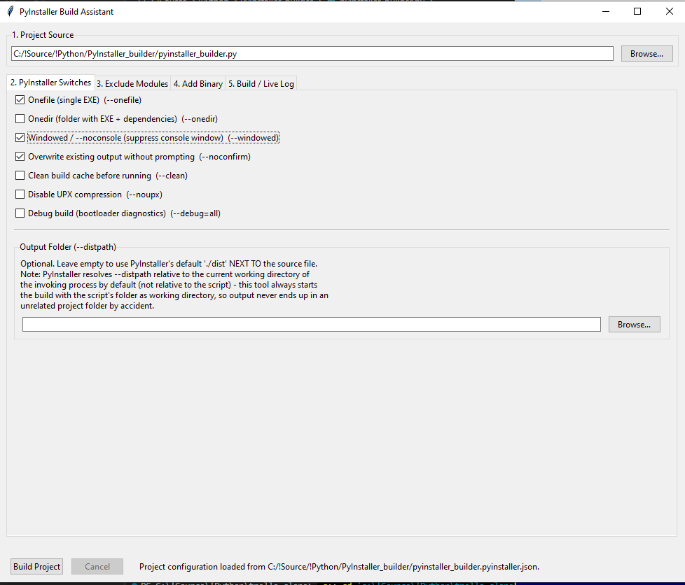
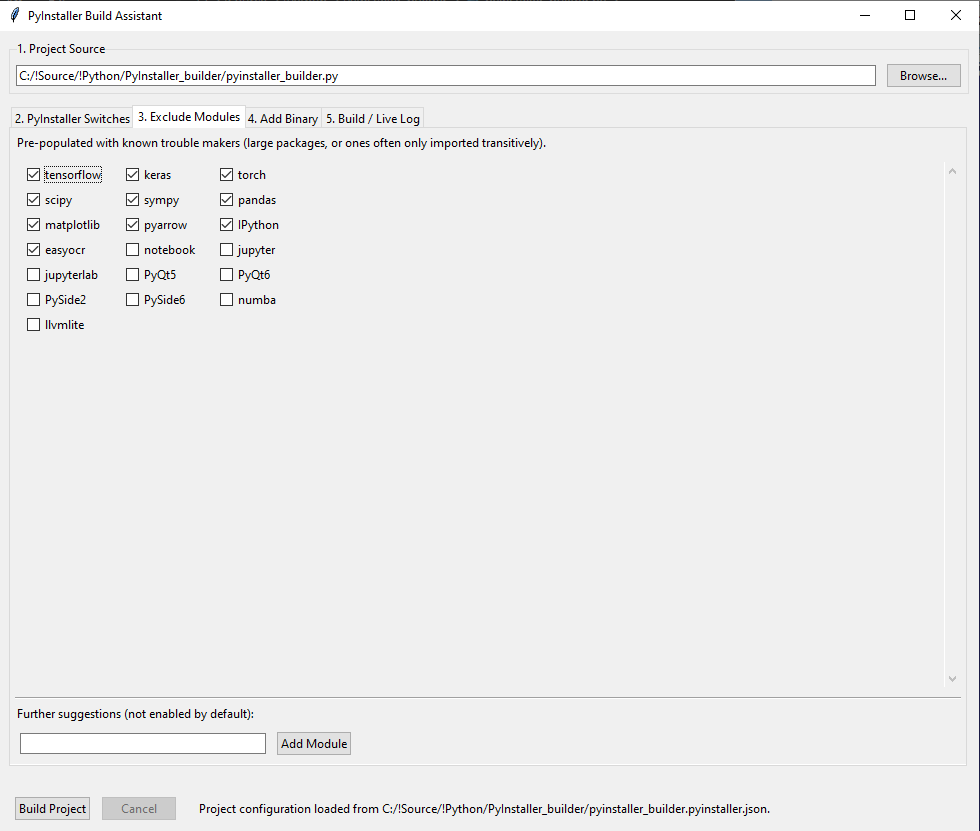
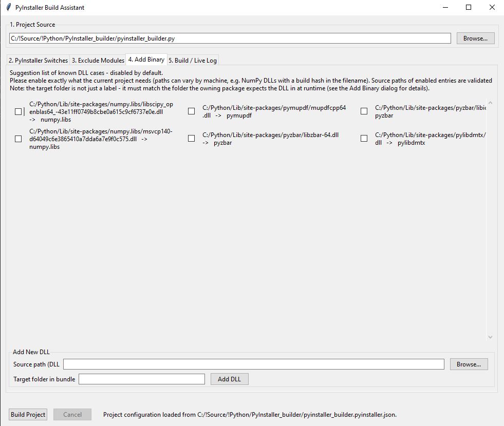
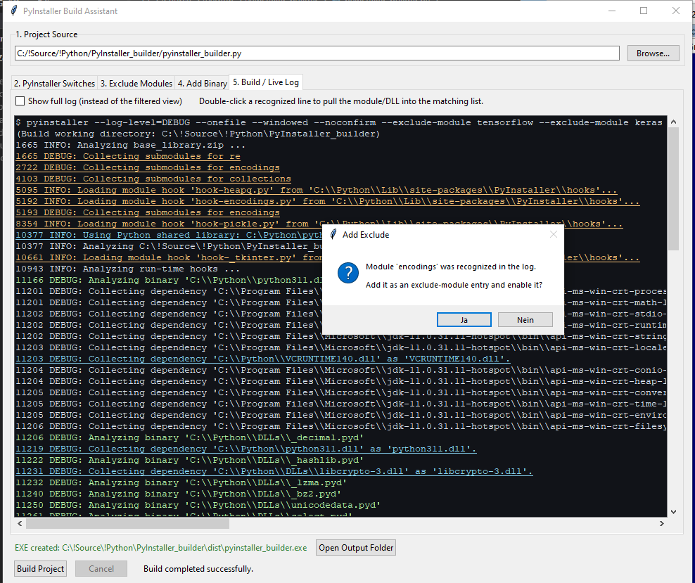

Note: This program was written entirely by Perplexity AI. I only guided it through the process. This is meant to be a community project. I suspect I won't have much, or any, time to add new features or fix bugs. Feel free to add your own changes, fixes, or new gadgets.

My development goal: I package all of my Python tools into standalone Windows executables with PyInstaller, and over time I had accumulated 10-15 commented-out PyInstaller command blocks in my scripts, each one a template for a different application with its own set of excluded modules and bundled DLLs. Copy-pasting and editing these blocks by hand was tedious, and worse, I had no visibility into *why* a build was taking forever, or which DLL was silently missing until the packaged executable failed at runtime. What started as "let's build a small GUI around this" turned, step by step, into a tool that not only assembles the PyInstaller command line for you, but actually lets you watch and steer the build live while it runs. The end result seemed useful enough to me that I thought others packaging Python apps might benefit from it too, so here it is.

I hope you like it,

Dietmar Bos

# PyInstaller Build Assistant

A Tkinter-based GUI that assembles, runs, and — most importantly — lets you *observe and steer* PyInstaller builds in real time, so that oversized or hanging builds stop being a black box.

## Why This Exists

Most PyInstaller GUI wrappers stop at the basics: pick a script, tick some checkboxes, click build. This tool does that too, but its actual reason for existing is different: **PyInstaller builds can silently take forever**, and the standard workflow gives you no way to find out why while it's happening. A package like `tensorflow` or `torch` might get pulled in transitively by something you *do* need, even though you never import it yourself and never intended to bundle it — and the only way to notice is to sit and wait, sometimes for many minutes, with no feedback about what's going on.

This tool turns the build itself into a diagnostic session:

- It runs PyInstaller with full `--log-level=DEBUG` output, parsed and streamed into the GUI **live**, line by line, while the build is still running — not after the fact from a log file.
- A filtered view suppresses the enormous amount of routine noise in PyInstaller's debug log (mainly bookkeeping around Windows system DLLs that get skipped anyway) and highlights the one line that actually tells you what's happening right now: `Analyzing binary '...'` or the module currently being collected.
- If a build is stuck on something you don't need (a large, transitively pulled-in package, or a DLL dependency chain you don't care about), you don't have to wait it out or restart from scratch guessing at command-line flags. You **double-click the offending line** in the live log, and it's added straight to the exclude-module or add-binary list — ready for an immediate rebuild.
- After a successful build, the tool cross-references PyInstaller's own `warn-<name>.txt` against your active excludes, flagging any case where a module reported as "missing" might actually be a module you excluded by mistake — before you ship a broken executable.

In short: it's not just a build launcher, it's a **build debugger** for the specific and common failure mode of "this is taking way too long and I don't know why."

## Features

### Project Setup

- **Per-project configuration** – settings are saved as `<scriptname>.pyinstaller.json` right next to the source file, so each project remembers its own switches, excludes, and binaries independently
- **PyInstaller switches via checkbox** – `--onefile`/`--onedir`, `--windowed`, `--noconfirm`, `--clean`, `--noupx`, `--debug=all`, plus an optional `--distpath` override
- **Correct working directory handling** – PyInstaller resolves `--distpath`/`--workpath` relative to the *current working directory of the calling process*, not the script. This tool always launches the build with the script's own folder as the working directory, so output never silently ends up in an unrelated project folder

### Exclude Modules & Add Binary

| Feature | Behavior |
|---|---|
| Pre-populated excludes | `tensorflow`, `keras`, `torch`, `scipy`, `sympy`, `pandas`, `matplotlib`, `pyarrow`, `IPython`, `easyocr` — enabled by default |
| Suggested extra excludes | `PyQt5/6`, `PySide2/6`, `numba`, `llvmlite`, Jupyter family — available, disabled by default |
| Pre-populated add-binary entries | Common real-world DLL cases (NumPy/OpenBLAS, PyMuPDF, pyzbar, pylibdmtx) — **disabled by default**, since DLL filenames and paths vary between machines |
| Scrollable multi-column grid | Both lists grow into a 3-column grid with vertical scrolling, so the list never runs out of room even with dozens of entries |
| Path validation | Before a build starts, every enabled add-binary source path is checked to exist; missing paths are flagged with the option to fix them first |
| Target-folder guidance | The add-binary target folder is not just a label — it is the actual extraction path inside the bundle at runtime. The tool pre-fills a sensible guess (the DLL's parent folder name in `site-packages`) and explains why it matters |

### Live Build & Debugging

- **Live, filtered log** with mouse-wheel and horizontal/vertical scrollbars for the often very wide DEBUG lines
- **Click-to-fix workflow** – double-click a highlighted module name (yellow) to add it to excludes, or a highlighted DLL path (blue) to add it to add-binary, right from the log
- **Hard cancel** – abort a runaway build at any point; the log is cleared automatically on the next run so old and new output are never mixed up
- **Full log toggle** – switch to the unfiltered raw output at any time; a complete log is always written to `<scriptname>.build.full.log` regardless of the view mode
- **Post-build diagnostics** – automatically parses `warn-<name>.txt` and flags any "missing module" warning that lines up with one of your active excludes
- **Success reporting** – on a successful build, the resulting `.exe` path is shown along with a button to open its containing folder directly

## Installation

### Requirements

- Python 3.10 or higher
- PyInstaller (installed in the same environment used to run this tool)
- Tkinter (included with most standard Python installations on Windows)

### Installing Dependencies

```
python -m pip install pyinstaller
```

### Running the Program

```
python pyinstaller_builder.py
```

## Usage

| Step | Action |
|---|---|
| 1. Project Source | Browse to your main `.py` script |
| 2. PyInstaller Switches | Tick the switches you need; optionally set a custom `--distpath` |
| 3. Exclude Modules | Review the pre-checked excludes, add your own, or enable a suggestion |
| 4. Add Binary | Enable and adjust the DLL entries your project actually needs |
| 5. Build / Live Log | Click "Build Project" — the log tab opens automatically and streams the build live |

While a build is running, double-click any highlighted line in the log to pull that module or DLL into the corresponding list, then cancel and rebuild.

## Screenshots









## Technical Details

### Project Structure

| Component | Purpose |
|---|---|
| `ProjectConfig` | Loads/saves the per-project JSON configuration, builds the final PyInstaller command line |
| `BuildRunner` | Runs PyInstaller in a background thread via `subprocess.Popen`, streams stdout line by line through a queue |
| `classify_line` / `is_noise_line` | Regex-based classification of DEBUG log lines into modules, DLLs, "analyzing" markers, or routine noise to suppress |
| `guess_dest_from_source` | Heuristic that derives a sensible `--add-binary` target folder from a DLL's source path |
| `PyInstallerBuilderApp` | The Tkinter GUI tying everything together: tabs, scrollable grids, live log view, event handling |

### How the Live Log Works

PyInstaller is invoked with `--log-level=DEBUG`, and its combined stdout/stderr is read line by line in a background thread using non-blocking queue-based communication with the Tkinter main loop (via `root.after` polling). This is what makes it possible to see progress *while the build runs*, rather than only after it finishes or fails.

### Dependencies

- **PyInstaller** – the actual packaging engine this tool wraps and observes
- **Tkinter** (standard library) – GUI toolkit

## Frequently Asked Questions

**Why are the add-binary entries disabled by default?**
DLL paths, especially for packages like NumPy, often include a build-specific hash in the filename that differs from machine to machine. Enabling everything by default would cause builds to fail on a fresh path that doesn't exist on your system. Enable only what your specific project needs, and adjust the path if necessary.

**My build seems stuck — what do I do?**
Switch to the Live Log tab and look at the last highlighted line (green = `Analyzing binary`, yellow = a module being collected). If it's something you don't need, cancel the build, double-click that line to add it to excludes or add-binary, and restart.

**I excluded a module and now the built executable crashes — why?**
Check the log after a successful build: any module reported as missing in `warn-<name>.txt` that matches one of your active excludes is flagged automatically. If the module is actually required at runtime, uncheck the exclude and rebuild.

**Does this tool replace understanding PyInstaller itself?**
No — it removes the tedium of retyping command-line flags and gives you visibility during the build, but the underlying concepts (hidden imports, hooks, binary dependency resolution) are still PyInstaller's own. This tool is a cockpit, not a black box that hides what's happening underneath.

## Credits

Developed with the help of Perplexity AI.

## License

MIT License – see the [LICENSE](LICENSE) file.

## Support

This is a community project. If you have questions or run into problems:

- Open an issue on GitHub
- Describe your problem in as much detail as possible, ideally including the relevant lines from the live log or the full build log file
- I'll try to help, but can't guarantee a response

**Note:** This project was developed with the help of AI (Perplexity AI).

## Changelog

### Version 1.0 (September 2026)

- Initial release
- Per-project configuration stored as JSON next to the source file
- Checkbox-driven PyInstaller switches, including `--distpath` override
- Pre-populated, individually toggleable exclude-module and add-binary lists
- Scrollable multi-column grid layout for both lists
- Live, filtered DEBUG log streaming with noise suppression and highlighted "analyzing" markers
- Click-to-fix workflow: pull modules/DLLs from the log directly into the exclude/add-binary lists
- Add-binary source path validation before build start, with a sensible target-folder guess
- Post-build cross-check of `warn-<name>.txt` against active excludes
- Success reporting with resulting EXE path and one-click folder access
